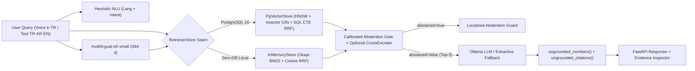

# Turkish Customer Support RAG v2 (`pgvector` + Turkish FTS + Multilingual-E5)

[](https://github.com/Mohammed-Darrige/turkish-customer-nlu-rag/actions/workflows/ci.yml)

Production-structured Turkish & multilingual (`TR` / `AR` / `EN`) Customer Support RAG Assistant grounded in consolidated Turkish consumer legislation (**6502 Sayılı Kanun**, **Mesafeli Sözleşmeler Yönetmeliği** including 2026 amendments, **Garanti Belgesi Yönetmeliği**, **Satış Sonrası Hizmetler Yönetmeliği**) and operational e-commerce support guides.

Built with **PostgreSQL 16 + `pgvector` (HNSW)**, **PostgreSQL Turkish Full-Text Search (`tsvector` GIN)**, **SQL-native Hybrid RRF (`k=60`)**, **FastAPI**, **Docker Compose**, **Web Speech API (`tr-TR`)**, and **dual post-generation guardrails** (numeric + `[doc_id:Madde N]` citation verification + calibrated out-of-scope abstention).

---

## Architecture



### Key Engineering Decisions
- **Deep `RetrieverStore` Seam (`src/stores/`):** Single protocol backed by `PgVectorStore` (PostgreSQL 16 `pgvector` HNSW `m=16, ef_construction=64` + Turkish `tsvector` GIN + SQL `FULL OUTER JOIN` CTE RRF) and `InMemoryStore` (Okapi BM25 + normalized cosine dot product) for zero-DB local development and unit tests.
- **Structure-Aware Legal Chunking (`src/ingestion/chunker.py`):** Splits consolidated statutory texts on `KISIM` / `BÖLÜM` / `MADDE` / `fıkra` boundaries with 1-fıkra overlap and contextual headers so legal exceptions stay attached to their governing rules.
- **No Keyword-Bonus Overfitting:** Zero hardcoded `kw_bonus` heuristics; evaluation splits `eval_dev.jsonl` (`N=30`, threshold calibration only) from held-out `eval_test.jsonl` (`N=120`, SHA-256 frozen).
- **Dual Grounding + Abstention:** Rejects out-of-scope traps instead of forcing a match, and verifies both numeric values and `[doc_id:Madde N]` citations against retrieved evidence.

---

## Corpus Provenance (`213` Chunks, `36,342` Words)

| `doc_id` | Source | Effective Date | Chunks |
| :--- | :--- | :--- | ---: |
| `kanun_6502` | 6502 Sayılı Tüketicinin Korunması Hakkında Kanun (`mevzuat.gov.tr`) | `2026-01-01` | 118 |
| `mesafeli_sozlesmeler` | Mesafeli Sözleşmeler Yönetmeliği (`mevzuat.gov.tr`, incl. 2026 return shipping rule) | `2026-01-01` | 30 |
| `satis_sonrasi` | Satış Sonrası Hizmetler Yönetmeliği (`mevzuat.gov.tr`) | `2014-06-13` | 23 |
| `garanti_belgesi` | Garanti Belgesi Yönetmeliği (`mevzuat.gov.tr`) | `2014-06-13` | 15 |
| `store_ops_faq` | Multilingual E-Commerce Operational Support Guides (`TR` / `AR` / `EN`) | `2026-01-01` | 27 |

Deterministic rebuild from `data/raw/`:
```bash
python scripts/ingest.py          # offline reproducible build (SHA-256 verified)
python scripts/ingest.py --fetch  # refresh snapshots from mevzuat.gov.tr
```

---

## Held-Out Benchmark (`data/eval_test.jsonl`, `N = 120`)

Measured by `scripts/evaluate.py` on `Windows AMD64` (`Python 3.13.12`, `intfloat/multilingual-e5-small`, `in_memory` store, `N=95` answerable queries + `N=25` out-of-scope traps). Full report: [`docs/benchmark.md`](docs/benchmark.md).

| Mode | Hit@1 (N=95) | Recall@3 | Recall@5 | MRR@5 | Abs. F1 (N=120) | Num. & Cite. Grounding | P50 (ms) |
| :--- | ---: | ---: | ---: | ---: | ---: | ---: | ---: |
| `lexical` | 53.7% | 65.3% | 72.6% | 0.606 | 14.3% | 100.0% / 100.0% | 3.15 |
| `dense` | 53.7% | 67.4% | 75.8% | 0.617 | 61.5% | 100.0% / 100.0% | 12.06 |
| **`hybrid`** | **58.9%** | **72.6%** | **80.0%** | **0.665** | **64.4%** | **100.0% / 100.0%** | **13.79** |

---

## Quickstart

### 1. Docker Compose (PostgreSQL 16 + `pgvector` + FastAPI)
```bash
docker compose up --build
# App & Voice/Text UI: http://127.0.0.1:8000
# API Docs:            http://127.0.0.1:8000/api/docs
```

### 2. Local Python (Zero-DB `InMemoryStore`)
```bash
pip install -r requirements.txt
uvicorn src.server:app --host 127.0.0.1 --port 8000
```

### 3. Tests & Reproducible Evaluation
```bash
RAG_ENABLE_DENSE=0 pytest -v tests/test_pipeline.py   # fast unit + API tests
pytest -v                                              # full dense + hybrid suite
python scripts/evaluate.py                             # regenerates docs/benchmark.md
```

Live PostgreSQL 16 + `pgvector` integration tests (`tests/test_pgvector.py`) run automatically in GitHub Actions against `pgvector/pgvector:pg16` (`test-pgvector` CI job).
