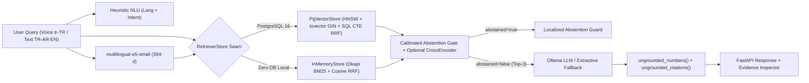

# Turkish Customer Support RAG v2 (`pgvector` + Turkish FTS + Multilingual-E5)

[](https://github.com/Mohammed-Darrige/turkish-customer-nlu-rag/actions/workflows/ci.yml)

Production-structured Turkish & multilingual (`TR` / `AR` / `EN`) Customer Support RAG Assistant grounded in consolidated Turkish consumer legislation (**6502 Sayılı Kanun**, **Mesafeli Sözleşmeler Yönetmeliği** including 2026 amendments, **Garanti Belgesi Yönetmeliği**, **Satış Sonrası Hizmetler Yönetmeliği**) and operational e-commerce support guides.

Built with **PostgreSQL 16 + `pgvector` (HNSW)**, **PostgreSQL Turkish Full-Text Search (`tsvector` GIN)**, **SQL-native Hybrid RRF (`k=60`)**, **Anthropic-style Contextual Retrieval**, **Snowball Turkish Stemming + MaxP Article Deduplication**, **2-Stage Cross-Encoder Reranking (`mmarco-mMiniLMv2-L12-H384-v1`)**, **Logit-Calibrated Out-of-Scope Abstention**, **FastAPI Microservice Observability (`X-Request-ID`, `GET /api/metrics`)**, **Docker Compose**, and **Web Speech API (`tr-TR`)**.

---

## Architecture



### Key Engineering Decisions
- **Deep `RetrieverStore` Seam (`src/stores/`):** Single protocol backed by `PgVectorStore` (PostgreSQL 16 `pgvector` HNSW `m=16, ef_construction=64`, `psycopg_pool.ConnectionPool`, configurable `RAG_EMBEDDING_DIM`, Turkish `tsvector` GIN, SQL `FULL OUTER JOIN` CTE RRF) and `InMemoryStore` (Snowball Turkish-stemmed Okapi BM25 + normalized cosine dot product) for zero-DB local development and unit tests.
- **Contextual Retrieval + MaxP Deduplication (`src/ingestion/chunker.py`, `src/rag_engine.py`):** Prepends deterministic statutory scope context (`data/raw/article_contexts.json`) to legal chunks before indexing and deduplicates top-k evidences by `citation_tag` (MaxP).
- **2-Stage Cross-Encoder Reranker + Logit-Calibrated Abstention:** Reranks top-20 hybrid candidates with `cross-encoder/mmarco-mMiniLMv2-L12-H384-v1` (enabled via `RAG_ENABLE_RERANKER=1`) and enforces a dev-calibrated logit abstention gate ($\tau = -1.504$ on `eval_dev.jsonl`, reducing OOS False Answer Rate to `4.0%`).
- **Microservice Observability (`src/server.py`):** HTTP middleware propagates/generates `X-Request-ID`, emits structured JSON request logs with `X-Process-Time-Ms`, and exposes `GET /api/metrics`.

---

## Corpus Provenance (`213` Chunks, `36,342` Words)

| `doc_id` | Source | Effective Date | Chunks |
| :--- | :--- | :--- | ---: |
| `kanun_6502` | 6502 Sayılı Tüketicinin Korunması Hakkında Kanun (`mevzuat.gov.tr`) | `2026-01-01` | 118 |
| `mesafeli_sozlesmeler` | Mesafeli Sözleşmeler Yönetmeliği (`mevzuat.gov.tr`, incl. 2026 return shipping rule) | `2026-01-01` | 30 |
| `satis_sonrasi` | Satış Sonrası Hizmetler Yönetmeliği (`mevzuat.gov.tr`) | `2014-06-13` | 23 |
| `garanti_belgesi` | Garanti Belgesi Yönetmeliği (`mevzuat.gov.tr`) | `2014-06-13` | 15 |
| `store_ops_faq` | Multilingual E-Commerce Operational Support Guides (`TR` / `AR` / `EN`) | `2026-01-01` | 27 |

Deterministic rebuild from `data/raw/`:
```bash
python scripts/ingest.py          # offline reproducible build (SHA-256 verified)
python scripts/ingest.py --fetch  # refresh snapshots from mevzuat.gov.tr
```

---

## Held-Out Benchmark (`data/eval_test.jsonl`, `N = 120`, Frozen SHA-256)

Measured by `scripts/evaluate.py` on `Windows AMD64` (`Python 3.13.12`, `intfloat/multilingual-e5-small` + `cross-encoder/mmarco-mMiniLMv2-L12-H384-v1`, `in_memory` store, `N=95` answerable queries + `N=25` out-of-scope traps). Grounding rates (`100.0% / 100.0%`) are measured under `use_llm=False` (`extractive_citation_fallback`); live Ollama retry/fallback rates depend on the local model runtime. Full report: [`docs/benchmark.md`](docs/benchmark.md).

| Mode | Hit@1 (N=95) | Recall@3 | Recall@5 | MRR@5 | Abs. F1 (N=120) | False Ans. Rate | P50 (ms) |
| :--- | ---: | ---: | ---: | ---: | ---: | ---: | ---: |
| `lexical` (Snowball + Context) | 64.2% | 75.8% | 83.2% | 0.718 | 14.3% | 92.0% | 96.65 |
| `dense` (`e5-small` + Context) | 63.2% | 80.0% | 84.2% | 0.714 | 64.2% | 32.0% | 110.64 |
| `hybrid` (RRF + MaxP) | 68.4% | 83.2% | 89.5% | 0.760 | 70.2% | 20.0% | 72.94 |
| **`hybrid_rerank` (+ mMARCO)** | **77.9%** | **89.5%** | **91.6%** | **0.840** | **85.7%** | **4.0%** | **378.54** |

### Turkish-First Scope vs. Cross-Lingual Ablation (`hybrid_rerank`)

| Slice | Queries | Hit@1 | Recall@3 | Recall@5 |
| :--- | ---: | ---: | ---: | ---: |
| **`turkish_primary` (`colloquial_tr` + `legal_exception`)** | **70** | **82.9%** | **95.7%** | **97.1%** |
| `cross_lingual` (Zero-shot `AR`/`EN` -> `TR` stress-test) | 25 | 64.0% | 72.0% | 76.0% |

---

## Quickstart

### 1. Docker Compose (PostgreSQL 16 + `pgvector` + FastAPI)
```bash
docker compose up --build
# App & Voice/Text UI: http://127.0.0.1:8000
# API Docs:            http://127.0.0.1:8000/api/docs
```

### 2. Local Python (Zero-DB `InMemoryStore`)
```bash
pip install -r requirements.txt
uvicorn src.server:app --host 127.0.0.1 --port 8000
```

### 3. Tests & Reproducible Evaluation
```bash
RAG_ENABLE_DENSE=0 pytest -v tests/test_pipeline.py   # fast unit + API tests
pytest -v                                              # full dense + hybrid suite
python scripts/evaluate.py                             # regenerates docs/benchmark.md
```

Live PostgreSQL 16 + `pgvector` integration tests (`tests/test_pgvector.py`) run automatically in GitHub Actions against `pgvector/pgvector:pg16` (`test-pgvector` CI job).
