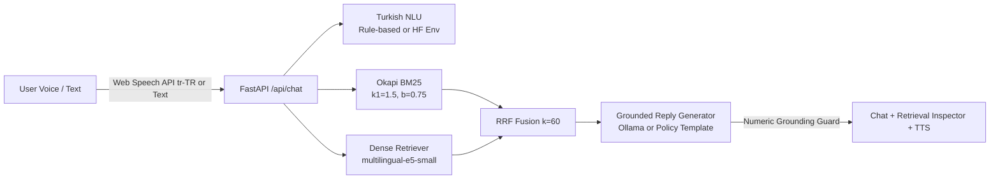

# Turkish Customer Support Voice & Text RAG Assistant

A focused, reproducible Turkish e-commerce customer support assistant combining **Okapi BM25**, **Multilingual-E5 Dense Retrieval**, **Reciprocal Rank Fusion (RRF)**, **rule-based Turkish NLU**, **numeric grounding verification** for local Ollama models, and a **Voice + Text Web UI**.

## Architecture



## Scope & Design Decisions

- **Focused RAG + Voice Assistant:** Handles customer support Q&A over a curated store policy corpus (`data/policies.json`) with voice input/output and a transparent retrieval/NLU inspector. Unrelated modules (tabular fraud/risk scoring, fake e-commerce storefront, seller desk) were intentionally excluded to keep the codebase clean and verifiable.
- **Honest Backend Reporting:** Every `/api/health` and `/api/chat` response reports the exact active backends (`rule_based_turkish_nlu`, `sentence_transformers:intfloat/multilingual-e5-small` or `disabled`, `ollama:<model>` or `policy_template_fallback`).
- **Numeric Grounding Guard:** When local Ollama is active, replies are checked with `ungrounded_numbers()` against the retrieved policy text and user message. If an unverified number (days, amounts, codes) appears, it retries once with a stricter prompt and otherwise falls back to the policy template.
- **No Hardcoded Local Paths:** Optional transformer NLU (`NLU_CATEGORY_MODEL`, `NLU_INTENT_MODEL`) and Cross-Encoder reranking (`RAG_RERANKER_MODEL`) are configured strictly via environment variables.

## Measured Benchmarks (`docs/benchmark.md`)

All metrics below are measured directly by [`scripts/evaluate.py`](scripts/evaluate.py) on Windows (AMD64), Python 3.13.12, CPU-only (`intfloat/multilingual-e5-small` + `rule_based_turkish_nlu`):

### 1. Policy-Level Retrieval Ablation (`data/eval_retrieval.jsonl`, N=21)

| Mode | Policy Hit@1 | Policy Hit@3 | MRR@3 | Mean Latency (ms) |
| :--- | :---: | :---: | :---: | :---: |
| `bm25` | 81.0% (17/21) | 95.2% (20/21) | 0.865 | 0.24 |
| `dense` | 71.4% (15/21) | 85.7% (18/21) | 0.786 | 9.58 |
| `hybrid` | 85.7% (18/21) | 90.5% (19/21) | 0.881 | 8.96 |

### 2. NLU Classification (`data/eval_nlu.jsonl`, N=20)

| Task | Macro F1 | Macro Precision | Macro Recall | Mean Latency (ms) |
| :--- | :---: | :---: | :---: | :---: |
| Category (5 classes) | 69.8% | 76.4% | 70.3% | 0.016 |
| Intent (3 classes) | 81.4% | 86.1% | 84.8% | — |

## Quick Start

### Local Python

```bash
pip install -r requirements.txt
uvicorn src.server:app --host 127.0.0.1 --port 8000
```

Open `http://127.0.0.1:8000` in Chrome or Edge for full Turkish voice input (STT) and speech output (TTS).

To run without downloading/loading the dense embedding model (BM25-only mode):

```bash
RAG_ENABLE_DENSE=0 uvicorn src.server:app --host 127.0.0.1 --port 8000
```

### Docker

```bash
docker compose up --build
```

### Optional Local LLM (Ollama)

If [Ollama](https://ollama.com/) is running locally with `gemma3:4b` (or any model configured via `OLLAMA_MODEL`), `/api/chat` will automatically use it for response phrasing while enforcing numeric grounding. Otherwise, it uses the deterministic policy template fallback.

## Testing & Evaluation

```bash
# Lightweight CI suite (BM25 + NLU + Grounding + FastAPI)
RAG_ENABLE_DENSE=0 pytest -v

# Full suite (includes multilingual-e5-small)
pytest -v

# Regenerate docs/benchmark.md from live evaluation
python scripts/evaluate.py
```

## API Endpoints

- `GET /api/health` — Readiness, policy count, active NLU/RAG/Ollama backends.
- `GET /api/policies` — Returns all 18 store policies from `data/policies.json`.
- `POST /api/chat` — Body: `{"message": "...", "top_k": 3, "retrieval_mode": "hybrid", "use_llm": true}`.

## Limitations

- **Corpus Scale:** The policy corpus contains 18 Turkish e-commerce support policies (`data/policies.json`). It is a focused domain demonstration, not a multi-thousand-document enterprise index.
- **Default NLU:** Without `NLU_CATEGORY_MODEL` and `NLU_INTENT_MODEL` set, NLU uses deterministic Turkish keyword/morphological rules (`69.8%` Category Macro F1 on the 20-query held-out set).
- **Voice Support:** Speech-to-Text (`SpeechRecognition`) and Text-to-Speech (`speechSynthesis`) rely on browser Web Speech APIs (`tr-TR`), which are best supported in Chromium-based browsers.
